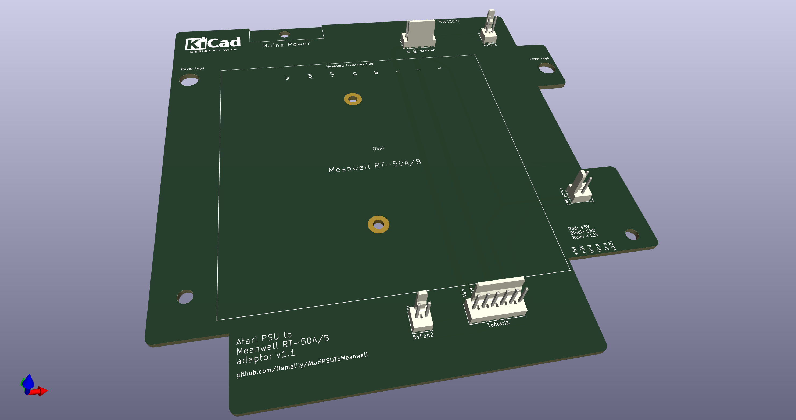

# AtariPSUToMeanwell
Create a board to mount the Meanwell PSU (RT-50A or RT-50B) into the Atari ST retro computer.

Taken inspiration from https://github.com/davepoo and his excellent project here
https://github.com/davepoo/AmigaPSUToMeanwell

